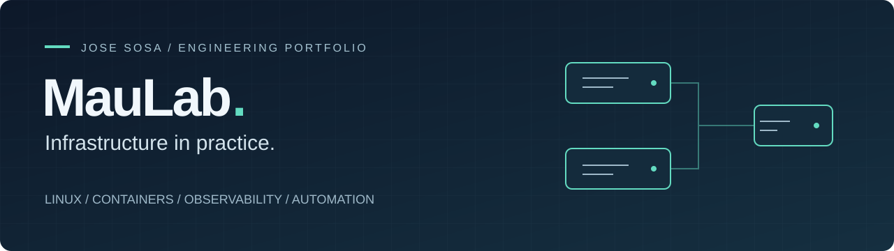
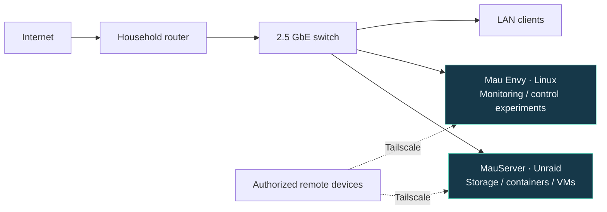

# MauLab

**A working homelab. An evolving engineering portfolio.**

I’m **Jose Sosa**, a network operations professional building practical DevOps skills through self-hosted infrastructure. MauLab brings together Linux administration, containerized services, observability, and repeatable maintenance—backed by **6+ years in network operations and technical support**.

[Architecture](docs/architecture.md) · [Runbook](docs/operations.md) · [Case studies](docs/case-studies.md) · [Roadmap](docs/roadmap.md) · [LinkedIn](https://www.linkedin.com/in/jose-sosa-783b49ab/)

## At a glance

| Platform | Operations | Engineering direction |
| --- | --- | --- |
| **Two complementary hosts** | **Observe, diagnose, validate** | **Make the work reproducible** |
| Unraid for storage and workloads; Linux for monitoring and control experiments | Prometheus, Grafana, Docker Compose, SSH, and Tailscale | Sanitized configuration examples, restore evidence, and documented experiments |

This is a personal learning environment. Hardware and service descriptions reflect documented lab work; the repository is not a live health dashboard or a complete deployment export.

## Selected engineering work

### 01 / Reliable backups

Nightly **systemd-based maintenance** with **14-day retention**, PostgreSQL dump validation, and SHA-256 integrity checks. The next milestone is an isolated restore exercise with recorded validation.

[Explore the backup case study →](docs/case-studies.md#case-study-1-backup-automation-and-integrity)

### 02 / Monitoring and service recovery

Operate a **Prometheus and Grafana** monitoring stack and troubleshoot Docker Compose services, including port conflicts. A separate Linux node supports ongoing control-display experiments.

[Explore the monitoring case study →](docs/case-studies.md#case-study-2-monitoring-service-recovery)

### 03 / Private remote administration

Use **Tailscale and SSH** to administer authorized systems. Document access boundaries and keep credentials, private addresses, and management endpoints outside the public portfolio.

[Explore the access approach →](docs/case-studies.md#case-study-3-remote-administration-boundary)

## Inside the lab

| System | Documented configuration | Role |
| --- | --- | --- |
| **MauServer** | Core i9-12900K · 32 GB RAM · RTX 3070 Ti · Unraid 7.3.2 | Primary storage, container, and virtualization host |
| **Mau Envy** | HP Envy · Ryzen 7 2700U · approximately 32 GB RAM · Linux | Monitoring, control deck, and kiosk experiments |
| **Network & rack** | Household router · 2.5 GbE switch · DeskPi RackMate T2 | Connectivity and physical lab organization |

[Full inventory and design decisions →](docs/architecture.md)

## Engineering notebook

| Start here | What you’ll find |
| --- | --- |
| [Architecture](docs/architecture.md) | Topology, hardware, system responsibilities, and design constraints |
| [Operations runbook](docs/operations.md) | Service inspection, incident triage, backup checks, and validation steps |
| [Engineering case studies](docs/case-studies.md) | Completed work, technical decisions, lessons, and next experiments |
| [Security approach](docs/security.md) | Private access, public documentation boundaries, and planned improvements |
| [Roadmap](docs/roadmap.md) | Current capabilities and the next stages of lab development |
| [Daily update guide](docs/daily-updates.md) | How repository activity is refreshed and how to maintain the automation |

## Repository activity

Automatically refreshed daily from Git history. These are repository changes, not infrastructure checks. Dates use **America/Chicago**.

<!-- activity:start -->
**Last refreshed:** 2026-10-31 05:49 CDT

**1 substantive commit in the last 24 hours.**

Latest changes on the main branch (automated activity refreshes excluded):

- **Oct 30, 2026** · docs: present MauLab as an engineering portfolio with runbooks and case studies · [`0d3c6c9`](https://github.com/Maulenos/MauLab/commit/0d3c6c972480dcdec1edf36e827deebc8b248f84)
- **Oct 27, 2026** · Add files via upload · [`74a351d`](https://github.com/Maulenos/MauLab/commit/74a351d2c1654629e56c0391ba43f51390cab8ee)
- **Oct 27, 2026** · Initial commit · [`d5a4641`](https://github.com/Maulenos/MauLab/commit/d5a464135cdd9108f9c8eb2474b996f2c11b89ba)
<!-- activity:end -->

[Browse all commits →](https://github.com/Maulenos/MauLab/commits/main/)

## What’s next

- **Reproducibility:** publish sanitized Compose examples and a small tested service demonstration.
- **Recovery evidence:** run an isolated restore drill and document the result.
- **Observability evidence:** add a redacted dashboard and a dated troubleshooting write-up.
- **Infrastructure as code:** develop bounded Ansible and Terraform experiments.

Kubernetes, dedicated firewall hardware, and VLAN segmentation remain planned learning work. [See the full roadmap →](docs/roadmap.md)

## About the engineer

My background includes NOC and technical support roles at **ICTX Wavemedia, Tachus, and WeLink Communications**, covering incident triage, troubleshooting, service restoration, escalation, and customer communication. I’m pursuing a **B.S. in Computer Science at Western Governors University**.

MauLab is where I translate that operational experience into hands-on infrastructure engineering: establish a baseline, investigate with evidence, validate changes, and turn lessons into reusable documentation.

[Connect on LinkedIn](https://www.linkedin.com/in/jose-sosa-783b49ab/) · [Explore my GitHub](https://github.com/Maulenos)

---

**Documentation-first portfolio.** Infrastructure configurations and backup data remain private. Documentation checks validate repository content; they do not test the running lab. Inventory baseline: **October 2026**.
