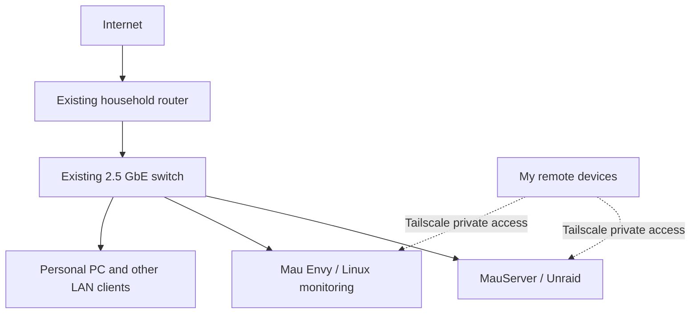

# MauLab — My Self-Hosted Networking & Infrastructure Homelab

*A work-in-progress homelab for learning networking, Linux, automation, and the infrastructure skills I want to use professionally.*

**Last updated:** October 27, 2026  
**Status:** Actively running and expanding  
**Focus:** Hands-on networking, systems administration, monitoring, security, and DevOps

## Why I'm building MauLab

I'm working toward a career in IT infrastructure, network engineering, and DevOps, while also pursuing my Computer Science education. MauLab is how I'm taking what I learn and applying it to real systems instead of stopping at tutorials or simulated exercises.

I started with computers and equipment I already had. Over time, I've been turning them into a small environment where I can host useful services, troubleshoot failures, access systems remotely, monitor uptime and performance, and practice making changes without affecting the rest of my household network.

It's not an enterprise lab yet, and that's part of the point. I want to understand *why* networks are designed the way they are by building mine one piece at a time, making mistakes in a controlled environment, documenting what I learn, and improving it.

## What I have running today

| Component | Current role | Status |
| --- | --- | --- |
| **MauServer** — Intel Core i9-12900K, 32 GB RAM, NVIDIA RTX 3070 Ti | Main Unraid host for storage, containers, virtual machines, media, and development projects | **In use** |
| **MauServer storage** — 14 TB-class Toshiba HDD and 1 TB WD_BLACK SN850 NVMe | File storage and fast local storage | **Installed** |
| **Mau Envy** — repurposed HP Envy / Ryzen 7 2700U, approximately 32 GB RAM | Linux-based control and monitoring node, with a kiosk display above the rack | **In use** |
| **DeskPi RackMate T2** | Compact physical rack for my growing infrastructure | **Owned / set up** |
| **Existing household router + 2.5 GbE switch** | Current LAN connectivity between the homelab and the rest of the network | **In use** |
| **Tailscale** | Secure remote access to systems and dashboards without unnecessarily exposing management tools to the public internet | **In use** |
| **Personal PC and ThinkPad** | Development, testing, SSH administration, and remote access | **In use** |

MauServer currently runs **Unraid 7.3.2**. The physical storage, virtual machines, and container environment give me practical experience with Linux, services, resource allocation, and troubleshooting. I use the lab for projects including my media and game-library services, custom applications, and infrastructure tooling.

On Mau Envy, I've worked on a **MauLab Control Deck** that brings useful status information together and supports monitoring and alerts. I've also built a **MauBot** workflow for project and server-status reporting. Part of the challenge has been making monitoring accessible when I need it, without leaving a display lit all day.

I've also experimented with **local AI-assisted code reviews** as part of a development workflow. That is a supporting project, though, not the main reason I'm pursuing this networking grant.

## How it's connected today

This is a simplified **current-state** diagram. It intentionally leaves out private addresses and management endpoints.

Right now the network is functional, but I'm limited by consumer network equipment. I don't yet have the dedicated firewall, managed switching, and isolated VLANs that would let me practice more advanced designs safely. I want the homelab to become a place where I can test those things deliberately instead of experimenting on the household's everyday connection.

## Projects I've worked on

- **Self-hosting and administration:** Running an Unraid system with storage, containers, and VMs; maintaining useful services and learning from real operational problems.
- **Private remote access:** Using Tailscale to reach my lab while away from home, rather than publishing administrative interfaces directly to the internet.
- **Monitoring and visibility:** Developing Mau Envy and my Control Deck to watch system health, check status, and surface alerts.
- **Service automation:** Building MauBot and related workflows to report on project and server status.
- **Software development:** Building and troubleshooting services such as MauCade and experimenting with local code-review agents. This gives me practical reasons to learn logging, networking, service reliability, and deployment.

I'm still learning. Some services and workflows are experiments, and not everything is production-ready. My goal is to be able to explain and troubleshoot every piece I run.

## The next stage: a networking lab I can learn from

These are **planned upgrades, not equipment I already have installed**.

| Planned addition | What I want to learn or improve |
| --- | --- |
| **Protectli VP6650 firewall appliance** | Build a dedicated routing/firewall environment, learn firewall rules, segmentation, VPN design, and policy management, potentially with OPNsense |
| **MikroTik CRS310 managed switch** | Practice VLANs, trunk/access ports, switching, network performance, and troubleshooting |
| **UPS / power protection** | Keep systems stable and practice safe shutdown and recovery |
| **Framework-based compute node** | Add virtualization and an environment for repeatable infrastructure experiments |
| **Two small SBC / Jetson nodes** | Run lightweight services, automation, monitoring, and distributed workloads |
| **Storage and server upgrades** | Improve backup/redundancy and capacity as the lab grows |

Longer term, I want to create a **separate lab network** with multiple VLANs (for example, trusted devices, servers, and experiments); define explicit firewall policies between those networks; collect metrics and logs; and document the decisions behind the design. I also want to work on repeatable deployments using Linux, Git, containers, and infrastructure-as-code tools, followed by Kubernetes when I have a solid networking foundation.

The **existing household internet must keep working** while I experiment. That means I plan to add isolation carefully and test changes before putting them into regular use.

## What a networking education grant would change

The biggest gap in MauLab is no longer having a computer to work with. It's having the **networking equipment and controlled environment** to go deeper.

Help with a managed switch, firewall equipment, cabling, and related networking lab materials would let me do exercises that are difficult to learn from an unmanaged home setup: VLAN configuration, segmentation, access control, routing, troubleshooting, and understanding how changes affect real services. I would document the topology, configuration choices, tests, failures, and lessons learned so my work becomes a useful portfolio for networking and infrastructure roles.

I don't expect a grant to build the entire lab for me. I've already been putting my own time, hardware, and effort into MauLab. The grant would help me get past a specific learning bottleneck and take the next step toward hands-on network engineering experience.

## What I'm working toward

My longer-term goal is to turn MauLab into an honest, well-documented portfolio of the skills I am learning: administering Linux systems, maintaining reliable services, designing segmented networks, monitoring infrastructure, responding to outages, automating repeatable work, and eventually building a small DevOps environment.

For me, MauLab isn't just a collection of hardware. It's where I practice becoming the kind of engineer who can build a system, understand what it does, keep it secure, and fix it when something goes wrong.

---

*This page distinguishes current equipment and tested work from proposed purchases and learning goals. Specific network addresses, access details, and credentials are intentionally not published.*
