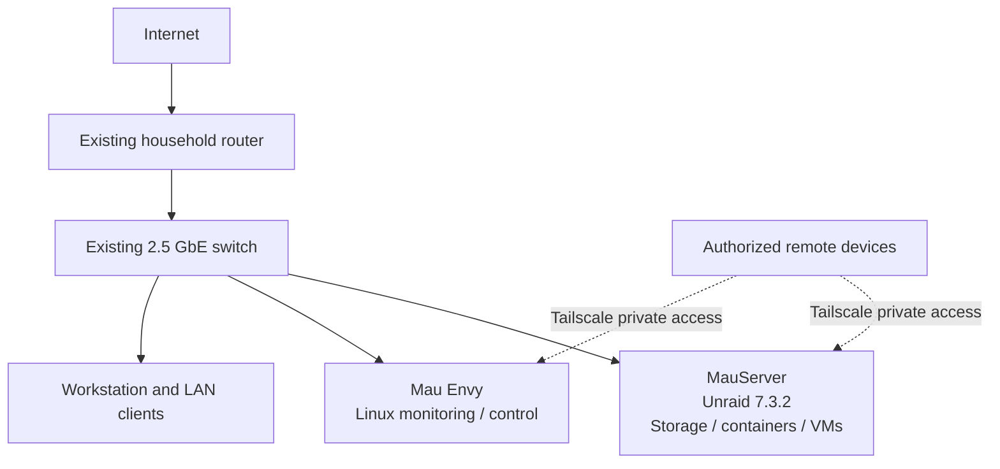

# MauLab

**Self-hosted infrastructure · Linux systems · Observability · Automation**

**MauLab is my hands-on infrastructure engineering portfolio.** I use real, self-hosted systems to practice administering Linux, operating containerized services, monitoring infrastructure health, troubleshooting incidents, and automating repeatable maintenance.

The project connects **6+ years of professional network operations and technical support** with practical DevOps/SRE engineering. It is a personal learning environment—not a claim of commercial production-scale infrastructure.

**Explore:** [Architecture](docs/architecture.md) · [Operations runbook](docs/operations.md) · [Engineering case studies](docs/case-studies.md) · [Security approach](docs/security.md) · [Roadmap](docs/roadmap.md)

---

## Engineering highlights

| Focus | What I implemented or practice | Technical evidence |
| --- | --- | --- |
| **Linux & systems** | Administer Ubuntu Server and Unraid systems, services, storage, and remote access | [Architecture & inventory](docs/architecture.md) |
| **Containers** | Deploy and troubleshoot self-hosted services with Docker and Docker Compose | [Operations runbook](docs/operations.md) |
| **Observability** | Collect and review host/service metrics with Prometheus and Grafana; troubleshoot monitoring availability | [Observability case study](docs/case-studies.md#case-study-2-monitoring-service-recovery) |
| **Reliability & automation** | Schedule nightly systemd-based backups; apply 14-day retention, PostgreSQL dump validation, and SHA-256 integrity checks | [Backup case study](docs/case-studies.md#case-study-1-backup-automation-and-integrity) |
| **Network operations** | Use SSH and Tailscale for remote administration and apply incident-triage practices learned in NOC roles | [Runbook](docs/operations.md) · [Security](docs/security.md) |
| **Documentation & change discipline** | Document current vs. planned architecture, troubleshooting steps, and operational checks | [Architecture](docs/architecture.md) · [Roadmap](docs/roadmap.md) |

## Current infrastructure

The diagram below intentionally omits private IP addresses, hostnames, and administrative endpoints.

| System | Role | Current state |
| --- | --- | --- |
| **MauServer** | Primary Unraid host for storage, container workloads, and virtual machines | Operating |
| **Mau Envy** | Repurposed Linux node for monitoring and local control-display experiments | Operating; interface evolving |
| **Network** | Household router and 2.5 GbE switching connecting lab and clients | Operating |
| **Remote administration** | SSH and Tailscale access for authorized devices | In use |
| **DeskPi RackMate T2** | Physical mounting and future network-lab expansion | Owned / set up |

See [architecture and infrastructure inventory](docs/architecture.md) for hardware details and the present limitations.

## Selected engineering work

### 01 — Backup automation and integrity

Implemented a nightly **systemd-based maintenance workflow**, including rolling retention, PostgreSQL backup validation, and SHA-256 integrity checks. The focus is not merely creating files, but making backup output verifiable and maintenance repeatable.

[Read the engineering case study](docs/case-studies.md#case-study-1-backup-automation-and-integrity)

### 02 — Monitoring recovery and container troubleshooting

Used **Prometheus, Grafana, Docker Compose, and Linux service troubleshooting** to improve visibility into the lab and investigate monitoring availability problems, including port conflicts.

[Read the engineering case study](docs/case-studies.md#case-study-2-monitoring-service-recovery)

### 03 — Private administration and safer experimentation

Use **Tailscale and SSH** for authorized remote access, keep public documentation sanitized, and plan to isolate more advanced networking experiments from the household's normal connectivity.

[Read the access and security approach](docs/security.md)

## Technology stack

| Area | Tools and technologies |
| --- | --- |
| Operating systems | Ubuntu Server, Unraid, Linux CLI, Windows |
| Containers and services | Docker, Docker Compose, systemd |
| Monitoring | Prometheus, Grafana |
| Networking and remote access | TCP/IP, DNS, DHCP, SSH, Tailscale, Cloudflare Tunnel |
| Data protection | PostgreSQL backup validation, SHA-256 checksums, retention workflows |
| Source control and documentation | GitHub, Markdown, Mermaid, GitHub Actions documentation checks |

**Scope note:** These are technologies used in the lab or supporting documented work. Kubernetes, Terraform, Ansible, and dedicated VLAN/firewall infrastructure are **learning goals, not claimed completed deployments**. See the [roadmap](docs/roadmap.md).

## How I approach engineering

1. **Establish a baseline:** document what is running, where it runs, and how to check health.
2. **Make changes deliberately:** inspect current state, consider failure and rollback paths, and validate the result.
3. **Investigate symptoms with evidence:** check service status, logs, ports, connectivity, and monitoring metrics.
4. **Automate repeatable work:** prioritize safe execution, retention, and integrity validation.
5. **Record what I learned:** turn troubleshooting and implementation decisions into reusable documentation.

The [operations runbook](docs/operations.md) includes example inspection and verification commands. It is guidance, not a claim that every command has been automated.

## About the engineer

I'm **Jose Sosa**, an infrastructure and network operations professional transitioning into DevOps engineering. My experience includes NOC and technical support work at ICTX Wavemedia, Tachus, and WeLink Communications: incident triage, network troubleshooting, service restoration, escalation, documentation, and customer communication.

I'm pursuing a **B.S. in Computer Science at Western Governors University (in progress)**. MauLab is where I translate operational experience and coursework into hands-on system engineering.

[LinkedIn](https://www.linkedin.com/in/jose-sosa-783b49ab/) · [GitHub profile](https://github.com/Maulenos)

## Repository guide

| Document | Purpose |
| --- | --- |
| [Architecture](docs/architecture.md) | Current topology, system roles, design constraints |
| [Operations](docs/operations.md) | Troubleshooting workflow and safe service checks |
| [Case studies](docs/case-studies.md) | Specific engineering work, decisions, and lessons |
| [Security](docs/security.md) | Remote access, operational boundaries, public-data policy |
| [Roadmap](docs/roadmap.md) | Clear separation between operating systems and future goals |

### About this repository

This is a **documentation-first portfolio**. It currently does **not** include a complete, ready-to-deploy export of my homelab or all private container configurations. The GitHub Actions workflow checks documentation structure and local links; it does **not** claim to test or deploy my infrastructure. Sanitized configuration examples, additional code, test evidence, and screenshots are future additions.

**Current state:** Active personal lab and evolving portfolio · **Last reviewed:** October 2026

---

*Public documentation intentionally excludes credentials, private addresses, access tokens, and sensitive endpoint details.*
