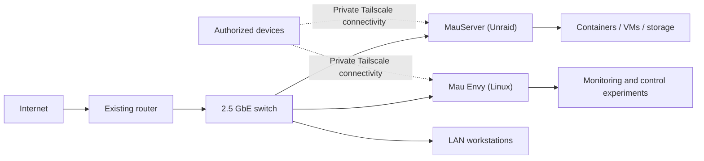
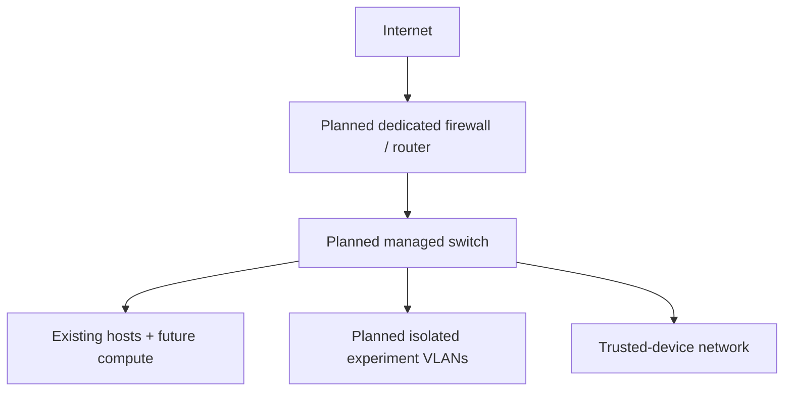

# Architecture and infrastructure inventory

[← Back to MauLab](../README.md) · [Operations](operations.md) · [Roadmap](roadmap.md)

## Design intent

MauLab is a small, self-hosted environment for operating services and practicing infrastructure engineering with equipment already available. The existing household network remains the default path for internet connectivity; advanced network isolation is a **future objective**.

Core design considerations:

- **Availability:** keep everyday household connectivity independent of risky experiments.
- **Visibility:** use service status, logs, metrics, and a separate monitoring/control node to investigate problems.
- **Remote management:** administer systems through authorized access rather than exposing management interfaces unnecessarily.
- **Recoverability:** preserve backup artifacts, validate integrity, and document restore procedures.
- **Practical constraints:** optimize for incremental learning and affordable hardware, not enterprise scale.

## Current logical topology

This is a **logical overview**, not a comprehensive physical, VLAN, or firewall diagram. Management ports, addressing, secret material, and detailed routes are intentionally omitted.

## Operating systems and hardware

| System | Hardware / platform | Responsibility |
| --- | --- | --- |
| **MauServer** | Intel Core i9-12900K, 32 GB RAM, NVIDIA RTX 3070 Ti; Unraid 7.3.2 | Storage, Docker services, VMs, experimentation |
| **Storage** | Toshiba 14 TB-class HDD; WD_BLACK SN850 1 TB NVMe | Persistent data and local fast storage |
| **Mau Envy** | Repurposed HP Envy, Ryzen 7 2700U, about 32 GB RAM; Linux | Control deck, monitoring, kiosk display experiments |
| **Networking** | Existing household router and 2.5 GbE switch | LAN connectivity and lab access |
| **DeskPi RackMate T2** | Compact rack enclosure | Physical lab organization |

Hardware details are point-in-time notes (October 2026), not an automated live inventory.

## Service responsibilities

### MauServer

- Hosts Unraid storage and a mix of containerized and virtualized workloads.
- Provides opportunities to practice Linux administration, container lifecycle management, resource allocation, and troubleshooting.
- Is the primary target for routine backup and verification workflows.

### Mau Envy

- Serves as a separate Linux-based monitoring/control experiment.
- Supports development of the **MauLab Control Deck** and status/alert workflows.
- Uses a nearby kiosk screen, with work underway to make the display available on demand rather than continuously on.

### Monitoring and visibility

Prometheus and Grafana are used to review host/network metrics and lab health. This is a learning-scale observability deployment; no uptime target, public SLO, on-call rotation, or enterprise-grade high availability is claimed.

## Connectivity and boundaries

- Use **Tailscale** for private access from authorized devices; SSH is used for host administration.
- Cloudflare Tunnel has been used for selected remote access experiments. An external tunnel is not a substitute for authentication or careful exposure decisions.
- Do not publish a management endpoint merely to make a demonstration link.
- The current network is **not yet** the dedicated VLAN-segmented architecture described in the roadmap.

Read [security and access boundaries](security.md).

## Planned architecture (not deployed)

Future candidates include a Protectli VP6650, a MikroTik CRS310, a UPS, and additional compute/SBC nodes. **None of these purchases or segmentation features should be interpreted as installed solely because they appear in this plan.** See the [roadmap](roadmap.md).

## Architecture questions under active investigation

1. How should the lab remain observable when its primary workload host is degraded?
2. Which services should live on MauServer versus a secondary control node?
3. What should the backup restore test look like, and how can results be recorded?
4. How can network segmentation be introduced without disrupting the existing household internet connection?

These questions are documented to guide experiments; they are not represented as resolved design decisions.
